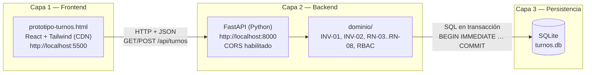
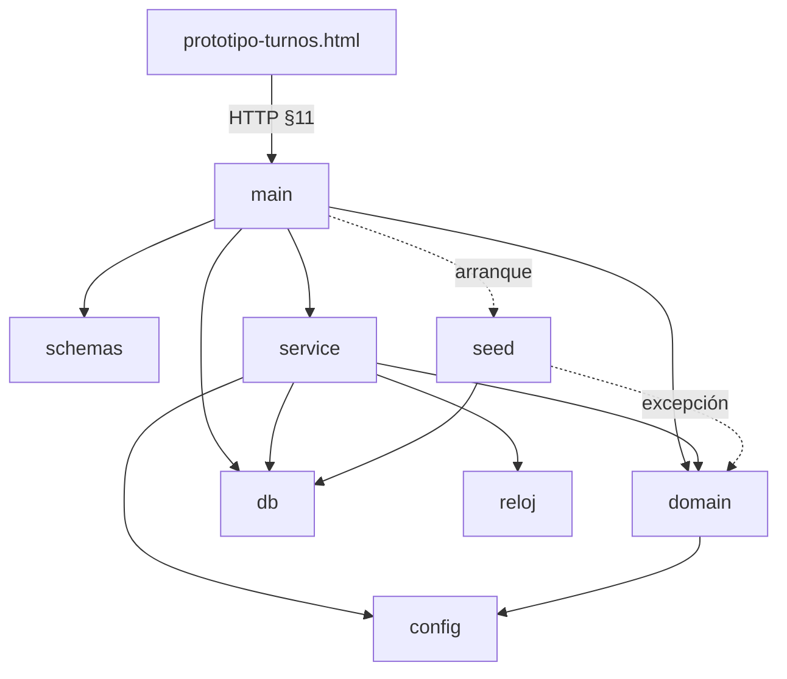

# plan.md — Fase 2: Arquitectura desacoplada y software real

| Campo | Valor |
|---|---|
| Versión | 2.2.0 |
| Versión anterior | 2.1.0 (contrato ampliado); 2.0.0 (contrato de turnos); antes, plan del prototipo en memoria (Fase 1), en el historial de git |
| Base normativa | [spec.md](spec.md) v2.2.0 · [historias-de-usuario.md](historias-de-usuario.md) |
| Prototipo de origen | [index.html](index.html) |
| Fecha | 2026-11-03 |
| Estado | Pendiente de aprobación |

> Este plan no agrega reglas: implementa las de spec.md v2.2.0. Si algo de este plan contradice la spec, manda la spec. Los cambios de la versión 2.1.0 están en la §8; la arquitectura en tres capas sobre el código real (v2.2.0), en la §9.

---

## 1. Punto de partida

La Fase 1 entregó `index.html`: un único archivo con React, un módulo de dominio (`domain/`) y un `store` con `useReducer`. Todas las reglas (RN-01 a RN-08, RBAC) corren **dentro del navegador** sobre datos mock en memoria. El propio README lo declara como límite: *"No hay persistencia: al recargar, los datos vuelven al estado inicial"* y *"La concurrencia está simulada"*.

La Fase 2 convierte ese prototipo en software real separando tres responsabilidades que hoy viven en un mismo archivo: **presentar**, **decidir** y **recordar**.

---

## 2. Por qué desacoplar: la memoria volátil de JS viola la integridad del sistema

Guardar los turnos en variables de JavaScript del navegador incumple la spec en cinco puntos concretos:

| # | Problema del estado en memoria (index.html) | Regla que se viola |
|---|---|---|
| 1 | **Se pierde al recargar.** Un `F5`, cerrar la pestaña o reiniciar la PC borra todos los turnos confirmados. El sistema "olvida" compromisos ya asumidos con clientes. | **INV-03** (sobrevivir al reinicio) |
| 2 | **Cada navegador tiene su propia verdad.** Dos clientes en dos computadoras ven dos copias independientes de la agenda. Ambos pueden reservar 10:00 con el mismo profesional y cada copia cree que el slot está libre. El reducer solo serializa acciones **dentro de una pestaña**. | **INV-02 / RN-02** (garantía ante concurrencia: *"una validación solo en la aplicación NO es suficiente"*) |
| 3 | **La regla vive del lado de quien la quiere saltar.** El dominio corre en el navegador del usuario: cualquiera puede abrir la consola y alterar el estado o llamar al reducer con otro rol (la guía de uso §5 lo hace a propósito para pruebas). | **RBAC-01** (*"la UI nunca es la barrera de seguridad"*) e **INV-01 / RN-01** (la ventana de 2 h se puede evadir) |
| 4 | **No hay atomicidad.** No existe una transacción que una "verificar slot libre + guardar turno + registrar auditoría". Un error a mitad de camino puede dejar un turno sin auditoría, o al revés. | **INV-03** (atomicidad) y **RN-08** |
| 5 | **El historial no es inmutable.** El log de auditoría y los turnos cancelados o completados desaparecen con la recarga. | **RN-06** (historial inmutable) y **RN-08** (auditoría inmutable) |

**Conclusión:** la integridad de un turno no puede depender de un proceso que el usuario controla y que muere al cerrar la pestaña. Por eso la decisión pasa al **Backend** (un único proceso que todos consultan) y la memoria pasa a una **base de datos relacional** con transacciones (un único almacenamiento durable). El navegador queda solo para presentar.

---

## 3. Arquitectura de 3 capas

> La §3 es el diseño original de v2.0.0. La versión normativa de las capas y sus reglas de dependencia está en spec.md §12, y su correspondencia con los módulos reales de `backend/` en la §9 de este plan.



| Capa | Responsabilidad | Qué **no** hace |
|---|---|---|
| 1 · Frontend | Mostrar datos y capturar intenciones del usuario. Traduce los códigos de error de la spec §7 a mensajes. | No decide si una reserva o cancelación es válida. No guarda turnos. |
| 2 · Backend | Única autoridad sobre las reglas. Aplica RBAC, INV-01, INV-02 y el resto de RN dentro de una transacción. | No guarda estado propio entre solicitudes: todo lo que importa está en la base. |
| 3 · Persistencia | Guardar de forma durable y reforzar las invariantes que la base puede garantizar (claves, `CHECK`, triggers). | No contiene lógica de presentación. |

### 3.1 Capa 1 — Frontend: `prototipo-turnos.html`

- **Origen:** se deriva de `index.html`, que se conserva sin cambios como referencia de la Fase 1.
- **Servido como estático** en `http://localhost:5500` (por ejemplo, `python -m http.server 5500` o Live Server). No se abre con doble clic (`file://`), porque CORS necesita un origen HTTP.
- **Cambios respecto de `index.html`:**

| Elemento de index.html | En prototipo-turnos.html |
|---|---|
| `state.turnos` del reducer | Se carga con `GET /api/turnos` al iniciar, al cambiar de usuario y después de cada acción. |
| `bookAppointment(...)` | `POST /api/turnos` con `{ servicio_id, inicio }` (y `cliente_id` si actúa un `ADMIN`). |
| `cancelAppointment(...)` | `POST /api/turnos/{id}/cancelar` con `{ motivo }`. |
| Validaciones de `domain/` sobre turnos | Se quitan del camino de decisión. La UI puede usarlas solo como ayuda visual (por ejemplo, deshabilitar "Cancelar" a menos de 2 h), pero el resultado lo decide la respuesta del Backend. |
| Selector de usuario/rol | Envía el `Usuario.id` elegido en el encabezado `X-Usuario-Id` (spec D-06). |
| Toasts de error | Muestran `error.mensaje` y usan `error.codigo` de la respuesta (spec §11.1). |
| Catálogo, horarios, bloqueos, métricas, emails | **v2.0.0:** datos locales con los mismos `id` que la semilla (spec D-08). **v2.1.0:** catálogo, horarios, disponibilidad, bloqueos, auditoría y métricas vienen del Backend (§8); solo la lista de usuarios sigue local, y los emails no existen (D-07). |
| Reloj simulado (+1 h, +1 día) | No afecta al Backend, que usa la hora real UTC. Se muestra deshabilitado o con una nota. |

- Una constante `API_BASE = "http://localhost:8000"` concentra la URL del Backend.
- Si el Backend no responde, la UI muestra "Sin conexión con el servidor" y **no** cae a datos en memoria (eso reintroduciría el problema de la §2).

### 3.2 Capa 2 — Backend: Python + FastAPI en el puerto 8000

- **Ejecución:** `uvicorn app.main:app --port 8000`.
- **CORS habilitado** con `CORSMiddleware`:
  - `allow_origins`: `http://localhost:5500` y `http://127.0.0.1:5500` (lista explícita, sin `*`).
  - `allow_methods`: `GET`, `POST`.
  - `allow_headers`: `Content-Type`, `X-Usuario-Id`.
- **Estructura propuesta:**

| Módulo | Contenido | Spec |
|---|---|---|
| `app/main.py` | Crea la app, CORS, manejador único de errores con el formato `{ "error": { "codigo", "mensaje" } }`. | §11.1 |
| `app/api/turnos.py` | Los tres endpoints del contrato. | §11.3 – §11.5 |
| `app/esquemas.py` | Modelos Pydantic: `TurnoOut` (exactamente los campos de `Turno` en §4.1), `ReservaIn`, `CancelacionIn`. Con `extra="forbid"` para rechazar `fin`, `profesional_id` y `estado`. | §11.2, §11.4 |
| `app/dominio/reglas.py` | Funciones puras portadas de `domain/` de index.html: solapamiento `[inicio, fin)`, ventana de cancelación, validación de contacto, grilla y horizonte, transiciones de estado. | INV-01, INV-02, RN-03 – RN-06 |
| `app/dominio/turnos.py` | Casos de uso `reservar` y `cancelar`: abren la transacción, aplican RBAC y reglas, escriben `turno` y `auditoria_evento`, confirman. | INV-03, RN-08 |
| `app/db.py` | Conexión SQLite, `PRAGMA`s y creación del esquema si no existe. | INV-03 |
| `app/semilla.py` | Carga inicial idempotente: los mismos profesionales, clientes, servicios, horarios y bloqueos que el mock de index.html. | D-08 |
| `app/config.py` | `CANCELLATION_WINDOW_HOURS=2`, antelación mínima 1 h, grilla 15 min, horizonte 60 días, ruta de `turnos.db`, zona horaria de operación. | RN-01, RN-04 |
| `app/reloj.py` | `ahora()` en UTC, inyectable para tests. | RN-01, RN-04 |

- **Flujo de una reserva** (`POST /api/turnos`):
  1. Resolver el actor con `X-Usuario-Id` → `401` si no existe o está inactivo.
  2. Validar el cuerpo → `422 VALIDATION_ERROR`.
  3. `BEGIN IMMEDIATE` (toma el bloqueo de escritura de la base: las reservas concurrentes esperan en fila).
  4. RBAC, servicio activo, contacto (RN-03), horario (RN-04), bloqueos (RN-05), solapamiento por profesional y por cliente (INV-02).
  5. `INSERT` en `turno` con `fin = inicio + duracion_min` y `profesional_id` del servicio.
  6. `INSERT` en `auditoria_evento` (`TURNO_CREADO`).
  7. `COMMIT` y recién entonces `201`. Ante cualquier error, `ROLLBACK` y el código de la spec §7.
- **Flujo de una cancelación** (`POST /api/turnos/{id}/cancelar`): igual, con `UPDATE` de `estado`, `motivo_cancelacion`, `cancelado_por_id`, `actualizado_en` e `INSERT` de `auditoria_evento` (`TURNO_CANCELADO`) en la misma transacción. La ventana de INV-01 se evalúa con `inicio - ahora(UTC)` dentro de la transacción.

### 3.3 Capa 3 — Persistencia: SQLite en `turnos.db`

- Archivo local `turnos.db` junto al Backend. Se agrega a `.gitignore` (la base no se versiona; se recrea con el esquema y la semilla).
- Conexión con:
  - `PRAGMA foreign_keys = ON` (SQLite las trae apagadas por defecto).
  - `PRAGMA journal_mode = WAL` (lecturas sin bloquear la escritura en curso).
  - `PRAGMA synchronous = FULL` (el `COMMIT` llega al disco antes de responder: INV-03).
  - `PRAGMA busy_timeout = 5000` (una reserva concurrente espera en lugar de fallar de inmediato).
- **Mapeo de tipos de la spec §4 a SQLite:**

| Tipo en spec §4 | SQLite | Nota |
|---|---|---|
| UUID | `TEXT` | Generado por el Backend (`uuid4`). |
| timestamp UTC | `TEXT` | ISO 8601 fijo `YYYY-MM-DDTHH:MM:SSZ`; así la comparación de texto ordena igual que el tiempo. |
| booleano | `INTEGER` | `0` / `1` con `CHECK`. |
| enum | `TEXT` | Con `CHECK (… IN (…))`. |
| decimal | `NUMERIC` | |
| entero | `INTEGER` | |
| `hora_inicio` / `hora_fin` | `TEXT` | `HH:MM`. |

#### 3.3.1 Esquema

Seis tablas, una por entidad de la spec §4.1, con **exactamente** sus atributos. Probado en SQLite 3 antes de escribir este plan.

```sql
CREATE TABLE usuario (
  id               TEXT PRIMARY KEY,
  email            TEXT NOT NULL UNIQUE,
  email_verificado INTEGER NOT NULL DEFAULT 0 CHECK (email_verificado IN (0, 1)),
  password_hash    TEXT NOT NULL,
  nombre_completo  TEXT NOT NULL CHECK (length(nombre_completo) BETWEEN 2 AND 100),
  telefono         TEXT NOT NULL,
  rol              TEXT NOT NULL CHECK (rol IN ('CLIENTE', 'PROFESIONAL', 'ADMIN')),
  activo           INTEGER NOT NULL DEFAULT 1 CHECK (activo IN (0, 1)),
  creado_en        TEXT NOT NULL
);

CREATE TABLE servicio (
  id                TEXT PRIMARY KEY,
  profesional_id    TEXT NOT NULL REFERENCES usuario(id),
  nombre            TEXT NOT NULL,
  descripcion       TEXT,
  duracion_min      INTEGER NOT NULL CHECK (duracion_min BETWEEN 15 AND 480 AND duracion_min % 15 = 0),
  precio_referencia NUMERIC NOT NULL CHECK (precio_referencia >= 0),
  activo            INTEGER NOT NULL DEFAULT 1 CHECK (activo IN (0, 1))
);

CREATE TABLE turno (
  id                 TEXT PRIMARY KEY,
  cliente_id         TEXT NOT NULL REFERENCES usuario(id),
  profesional_id     TEXT NOT NULL REFERENCES usuario(id),
  servicio_id        TEXT NOT NULL REFERENCES servicio(id),
  inicio             TEXT NOT NULL,
  fin                TEXT NOT NULL,
  estado             TEXT NOT NULL CHECK (estado IN ('CONFIRMADO', 'CANCELADO', 'COMPLETADO', 'AUSENTE')),
  motivo_cancelacion TEXT,
  cancelado_por_id   TEXT REFERENCES usuario(id),
  creado_en          TEXT NOT NULL,
  actualizado_en     TEXT NOT NULL,
  CHECK (inicio < fin),
  CHECK (cliente_id <> profesional_id)            -- spec §4.3
);
CREATE INDEX ix_turno_profesional_inicio ON turno (profesional_id, inicio);
CREATE INDEX ix_turno_cliente_inicio     ON turno (cliente_id, inicio);

CREATE TABLE horario_laboral (
  id             TEXT PRIMARY KEY,
  profesional_id TEXT NOT NULL REFERENCES usuario(id),
  dia_semana     INTEGER NOT NULL CHECK (dia_semana BETWEEN 0 AND 6),
  hora_inicio    TEXT NOT NULL,
  hora_fin       TEXT NOT NULL,
  CHECK (hora_inicio < hora_fin)
);

CREATE TABLE bloqueo (
  id             TEXT PRIMARY KEY,
  profesional_id TEXT NOT NULL REFERENCES usuario(id),
  inicio         TEXT NOT NULL,
  fin            TEXT NOT NULL,
  motivo         TEXT,
  CHECK (inicio < fin)
);

CREATE TABLE auditoria_evento (
  id          TEXT PRIMARY KEY,
  entidad     TEXT NOT NULL,
  entidad_id  TEXT NOT NULL,
  accion      TEXT NOT NULL,
  actor_id    TEXT NOT NULL REFERENCES usuario(id),
  rol         TEXT NOT NULL CHECK (rol IN ('CLIENTE', 'PROFESIONAL', 'ADMIN')),
  ocurrido_en TEXT NOT NULL,
  detalle     TEXT
);
```

Ninguna FK hacia `turno` usa `ON DELETE CASCADE` (spec §4.3).

#### 3.3.2 Invariantes reforzadas en la base

SQLite no tiene `EXCLUDE USING gist`. La spec RN-02 admite la alternativa *"transacción con bloqueo + restricción equivalente"*, que se implementa así:

1. **Bloqueo:** toda escritura de turnos abre `BEGIN IMMEDIATE`, que serializa a los escritores.
2. **Restricción en la base:** triggers que rechazan la escritura aunque el Backend tuviera un error.

```sql
-- INV-02 / RN-02: sin solapamiento por profesional ni por cliente, ni con bloqueos.
CREATE TRIGGER trg_turno_solapamiento
BEFORE INSERT ON turno
WHEN NEW.estado = 'CONFIRMADO'
BEGIN
  SELECT RAISE(ABORT, 'SLOT_UNAVAILABLE')
  WHERE EXISTS (
    SELECT 1 FROM turno t
    WHERE t.estado = 'CONFIRMADO'
      AND (t.profesional_id = NEW.profesional_id OR t.cliente_id = NEW.cliente_id)
      AND t.inicio < NEW.fin AND NEW.inicio < t.fin
  ) OR EXISTS (
    SELECT 1 FROM bloqueo b
    WHERE b.profesional_id = NEW.profesional_id
      AND b.inicio < NEW.fin AND NEW.inicio < b.fin
  );
END;

-- spec §4.3: el profesional del turno es el del servicio.
CREATE TRIGGER trg_turno_profesional_servicio
BEFORE INSERT ON turno
BEGIN
  SELECT RAISE(ABORT, 'Turno.profesional_id debe coincidir con Servicio.profesional_id')
  WHERE NEW.profesional_id <> (SELECT profesional_id FROM servicio WHERE id = NEW.servicio_id);
END;

-- RN-06: estados terminales y sin reprogramación.
CREATE TRIGGER trg_turno_transicion
BEFORE UPDATE ON turno
BEGIN
  SELECT RAISE(ABORT, 'INVALID_STATE_TRANSITION')
  WHERE OLD.estado <> 'CONFIRMADO'
     OR NEW.inicio <> OLD.inicio OR NEW.fin <> OLD.fin
     OR NEW.cliente_id <> OLD.cliente_id OR NEW.profesional_id <> OLD.profesional_id
     OR NEW.servicio_id <> OLD.servicio_id;
END;

-- RN-06: sin borrado físico de turnos.
CREATE TRIGGER trg_turno_sin_borrado BEFORE DELETE ON turno
BEGIN SELECT RAISE(ABORT, 'INVALID_STATE_TRANSITION: el historial es inmutable'); END;

-- RN-08: auditoría inmutable.
CREATE TRIGGER trg_auditoria_sin_update BEFORE UPDATE ON auditoria_evento
BEGIN SELECT RAISE(ABORT, 'La auditoría es inmutable'); END;
CREATE TRIGGER trg_auditoria_sin_borrado BEFORE DELETE ON auditoria_evento
BEGIN SELECT RAISE(ABORT, 'La auditoría es inmutable'); END;
```

Prueba hecha sobre este esquema: rechaza el solapamiento con el mismo profesional, con un turno del mismo cliente y con un bloqueo; acepta turnos contiguos (`fin == inicio`); libera el slot al cancelar; rechaza reabrir un turno cancelado, moverlo de horario o borrarlo; y los turnos siguen ahí al cerrar y reabrir la base.

---

## 4. Grounding: solo entidades de la spec §4

**Directiva:** prohibido inventar entidades, tablas o campos que no figuren en la sección 4 de spec.md.

| Entidad spec §4.1 | Tabla | Campos |
|---|---|---|
| Usuario | `usuario` | Los 9 de la spec, sin agregados |
| Servicio | `servicio` | Los 7 de la spec, sin agregados |
| Turno | `turno` | Los 11 de la spec, sin agregados |
| HorarioLaboral | `horario_laboral` | Los 5 de la spec, sin agregados |
| Bloqueo | `bloqueo` | Los 5 de la spec, sin agregados |
| AuditoriaEvento | `auditoria_evento` | Los 8 de la spec, sin agregados |

**Lo que el prototipo usa y que, por esta directiva, NO se persiste:**

| En index.html | Decisión en Fase 2 |
|---|---|
| Bandeja de emails simulados (F-13) | No hay entidad en la §4. El Backend no persiste emails (spec D-07). |
| `canceladoRol` en el turno | No es campo de `Turno`. El rol de quien canceló queda en `auditoria_evento.rol`. |
| `CONFIG` y reloj simulado | Son configuración (`app/config.py`) y reloj (`app/reloj.py`), no datos. |
| Sesión / token de login | Fuera del contrato v2.0.0. Se usa el encabezado `X-Usuario-Id` (spec D-06). No se crea tabla de sesiones. |

Cualquier tabla nueva (por ejemplo, emails o sesiones) exige primero una versión nueva de la spec §4.

---

## 5. Verificación

Tests automáticos con `pytest` y el `TestClient` de FastAPI, sobre una `turnos.db` temporal por test:

| Escenario (spec §8) | Cómo se prueba |
|---|---|
| 1, 3 · Solapamiento y contigüidad | `POST /api/turnos` sobre slots ocupados y contiguos. |
| 2, 12 · Concurrencia (INV-02) | Varios hilos hacen `POST` al mismo slot libre: exactamente un `201`, el resto `409 SLOT_UNAVAILABLE`. |
| 4, 5, 11 · Ventana de cancelación (INV-01) | Reloj inyectado a 3 h y a 1 h 59 min del inicio. |
| 6 · Contacto inválido | Cliente semilla sin teléfono válido. |
| 7 · Aislamiento | Cliente B pide cancelar el turno de A → `404`; `GET` de B no lo incluye. |
| 9 · Persistencia ante reinicio (INV-03) | Crear turno, cerrar la app y la conexión, abrir otra sobre el mismo archivo y verificar con `GET`. Prueba manual equivalente: reiniciar `uvicorn` y recargar el navegador. |
| 10 · Atomicidad (INV-03) | Forzar una falla al insertar la auditoría y verificar que el turno no existe. |
| Triggers | Inserciones directas por SQL que saltean el Backend y deben ser rechazadas. |
| CORS | Una solicitud con `Origin: http://localhost:5500` recibe `Access-Control-Allow-Origin`; un origen no listado, no. |

Prueba de punta a punta manual: Backend en `:8000`, frontend en `:5500`, reservar desde dos navegadores el mismo slot y comprobar que solo uno lo obtiene.

---

## 6. Orden de trabajo propuesto

1. Esquema y `app/db.py` con los `PRAGMA` (§3.3).
2. Semilla con los datos del mock de index.html.
3. `app/dominio/reglas.py` portado desde `domain/`, con tests unitarios.
4. Endpoints `GET`, `POST` y `cancelar` con su manejo de errores (spec §11).
5. Tests de §5.
6. `prototipo-turnos.html` derivado de index.html, consumiendo la API.
7. Prueba de punta a punta y actualización del README.

---

## 7. Decisiones tomadas y preguntas abiertas

| # | Tema | Decisión |
|---|---|---|
| 1 | Motor de base de datos | SQLite (`turnos.db`), según spec D-04. |
| 2 | Identificación del actor | Encabezado `X-Usuario-Id`, según spec D-06. |
| 3 | `index.html` | Se conserva sin cambios como prototipo de la Fase 1. |
| 4 | Catálogo, horarios, bloqueos y métricas en el frontend | v2.0.0: datos locales alineados con la semilla (D-08). v2.1.0: vienen de la API (§8). |
| 5 | Reloj simulado | No se envía al Backend. Queda como pregunta abierta si se quiere un modo de prueba con reloj controlado. |
| 6 | Emails (F-13) | No se persisten en Fase 2 (D-07). |
| 7 | Estructura de módulos del Backend | Los módulos están planos en `backend/` (`main.py`, `service.py`, `domain.py`, `db.py`, `seed.py`, `reloj.py`, `schemas.py`) en lugar del paquete `app/` de la §3.2. El contrato y el comportamiento no cambian; queda como tarea opcional. |

---

## 8. Cambios de la versión 2.1.0

La spec v2.1.0 agrega a la §11 los endpoints que en v2.0.0 estaban fuera de contrato (D-08), **sin cambiar la §4 ni las invariantes INV-01 a INV-03**. No hay tablas ni campos nuevos.

### 8.1 Backend

| Endpoint (spec) | Caso de uso (`backend/service.py`) | Regla |
|---|---|---|
| `GET /api/servicios` (§11.6) | `listar_servicios` | F-02, público |
| `POST /api/servicios/{id}/activar` · `/desactivar` (§11.7) | `cambiar_activo_servicio` | RN-07: baja lógica, no toca turnos |
| `GET` / `POST /api/horarios` (§11.8) | `listar_horarios`, `reemplazar_horario` | F-08, D-09 |
| `GET /api/disponibilidad` (§11.9) | `disponibilidad` (+ `domain.slots_del_dia`) | F-03, RN-02, RN-04, RN-05 |
| `GET` / `POST /api/bloqueos`, `POST /api/bloqueos/{id}/eliminar` (§11.10) | `listar_bloqueos`, `crear_bloqueo`, `eliminar_bloqueo` | RN-05 con conflictos y confirmación |
| `POST /api/turnos/{id}/completar` · `/ausente` (§11.11) | `cerrar_turno` (+ `domain.validar_cierre`) | RN-06 |
| `GET /api/auditoria` (§11.12) | `auditoria` | RN-08, solo lectura |
| `GET /api/metricas` (§11.13) | `metricas` (+ `domain.calcular_metricas`, `minutos_disponibles`) | F-12, spec §5 |

- Todas las escrituras usan `BEGIN IMMEDIATE` y registran su `AuditoriaEvento` en la misma transacción (INV-03). En el bloqueo con confirmación, las cancelaciones de turnos, el bloqueo y sus eventos van en una sola transacción.
- Las lecturas públicas (`servicios`, `horarios`, `disponibilidad`) aceptan solicitudes sin `X-Usuario-Id` (spec §11.1).
- CORS sin cambios: todas las acciones nuevas son `POST`.

### 8.2 Frontend (`prototipo-turnos.html`)

| Pantalla | v2.1.0 |
|---|---|
| Vista Cliente: servicios y horarios libres | `GET /api/servicios` y `GET /api/disponibilidad`. La grilla ya no es orientativa: considera las reservas de todos los clientes. |
| Agenda | Bloqueos con `GET /api/bloqueos`. Completar y Ausente con `POST /api/turnos/{id}/completar` · `/ausente`. |
| Bloqueos | Crear y eliminar. Si el servidor devuelve `conflictos`, el modal los lista y pide motivo para cancelarlos. |
| Horarios (pestaña nueva) | Edita el horario semanal y lo guarda con `POST /api/horarios`. |
| Servicios | Activar y desactivar. |
| Auditoría | Tabla de `GET /api/auditoria`. |
| Métricas | `GET /api/metricas` para la semana, el mes o los últimos 300 días más el horizonte. |

Solo la lista de usuarios sigue local (no hay endpoint de usuarios, RBAC-04).

### 8.3 Verificación

`backend/tests/test_v21.py` cubre los criterios 8 y 13 a 20 de spec §8, los permisos y los errores de cada endpoint nuevo, y la atomicidad del bloqueo con cancelaciones cuando falla la auditoría.

---

## 9. Arquitectura en tres capas sobre el código real (v2.2.0)

La spec v2.2.0 agrega la §12, que fija las tres capas y las reglas de dependencia ARQ-01 a ARQ-07. **No cambia código, contrato ni esquema:** describe la estructura que ya tiene el repositorio y la vuelve verificable.

### 9.1 Módulos por capa

| Capa | Archivo | Rol | Depende de |
|---|---|---|---|
| Presentación | `prototipo-turnos.html` | SPA React + Tailwind (CDN) en `:5500`. La función `api()` envía cada solicitud a `API_BASE` con `X-Usuario-Id` y convierte las respuestas de error en `ApiError`. | Solo el contrato HTTP de spec §11 |
| Negocio · adaptador HTTP | `backend/main.py` | App FastAPI, CORS, una conexión por solicitud, resolución del actor y manejadores de `ErrorDominio`, `RequestValidationError` y `sqlite3.Error`. | `schemas`, `service`, `domain` (catálogo `HTTP` y `ErrorDominio`), `db.connect`, `seed` (solo al arrancar), `config` |
| Negocio · adaptador HTTP | `backend/schemas.py` | Modelos Pydantic con `extra="forbid"`: forma de entrada y salida de spec §11.2 y §11.14. | Solo `pydantic` y la biblioteca estándar |
| Negocio · casos de uso | `backend/service.py` | Una función por endpoint: RBAC, `db.transaccion`, consultas SQL, auditoría (`_auditar`). | `domain`, `db`, `reloj`, `config` |
| Negocio · dominio | `backend/domain.py` | Reglas puras y catálogo de errores de spec §7. | `config` |
| Datos | `backend/db.py` | Esquema de las seis tablas de spec §4.1, triggers, `PRAGMA`, `connect` y `transaccion` (`BEGIN IMMEDIATE`). | Solo la biblioteca estándar |
| Datos | `backend/turnos.db` | Archivo SQLite (no versionado). | — |
| Datos · arranque | `backend/seed.py` | Semilla idempotente al iniciar la app. | `db`, `config`, `reloj`, `domain.dentro_de_horario` (excepción de spec §12.3) |
| Transversal | `backend/config.py`, `backend/reloj.py` | Parámetros y hora UTC. | Solo la biblioteca estándar |

Los tests siguen la misma división: `test_domain.py` prueba el dominio sin base, `test_reglas.py` y `test_v21.py` prueban los casos de uso con una base real, y `test_api.py` y `test_concurrencia.py` prueban el sistema a través de HTTP.

### 9.2 Grafo de dependencias real



Todas las flechas apuntan hacia abajo; no hay ciclos ni imports de una capa inferior a una superior. `main → db` es solo `db.connect` (ARQ-05).

### 9.3 Cómo se verifica

Las reglas ARQ se pueden comprobar con búsquedas sobre `backend/` (desde la raíz del repositorio):

| Regla | Comprobación | Resultado esperado |
|---|---|---|
| ARQ-03 | `grep -nE "^(import\|from) " backend/domain.py` | Solo `re`, `datetime` y `config` |
| ARQ-04 | `grep -nE "fastapi\|schemas\|import main" backend/service.py` | Sin coincidencias |
| ARQ-05 | `grep -n "execute" backend/main.py` | Sin coincidencias |
| ARQ-06 | `grep -nE "^(import\|from) " backend/db.py` | Solo `sqlite3`, `contextlib` y `pathlib` |
| ARQ-01 | `grep -n "fetch(" prototipo-turnos.html` | Un único `fetch`, dentro de `api()`, contra `API_BASE` |

Estado al 2026-11-03: las cinco comprobaciones dan el resultado esperado.

### 9.4 Diferencias con la §3 y deuda conocida

- **Rutas de módulos.** La §3.2 propone el paquete `app/` (`app/api/turnos.py`, `app/dominio/reglas.py`, `app/dominio/turnos.py`, …). El código real está plano en `backend/` (decisión 7 de la §7). La equivalencia es: `app/dominio/reglas.py` → `domain.py`, `app/dominio/turnos.py` → `service.py`, `app/api/turnos.py` y `app/main.py` → `main.py`, `app/esquemas.py` → `schemas.py`, `app/semilla.py` → `seed.py`.
- **SQL dentro de los casos de uso.** `service.py` escribe sus consultas SQL directamente sobre la conexión. Cumple ARQ-05 (es la única puerta a la base en tiempo de solicitud), pero mezcla orquestación y acceso a datos. Si la base cambia de motor, conviene extraer un módulo de repositorio en la capa de datos; queda como tarea opcional, sin cambio de contrato.
- **Excepción de `seed.py`.** Documentada en spec §12.3.
