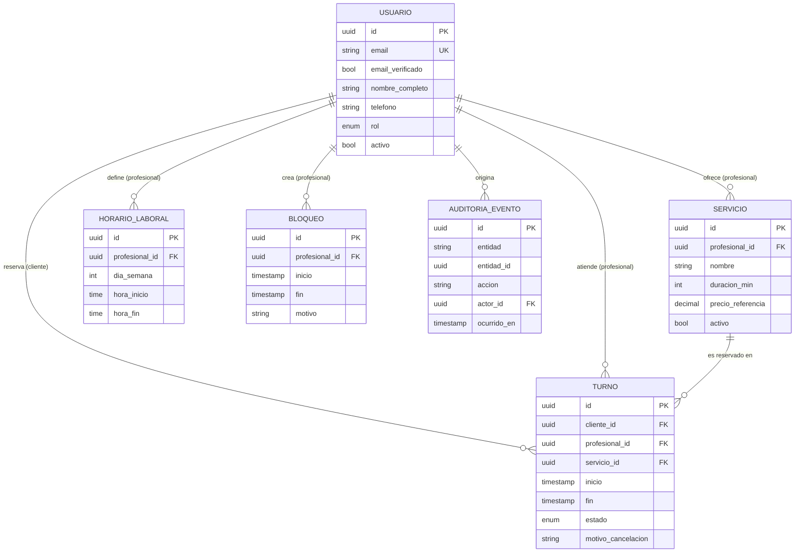
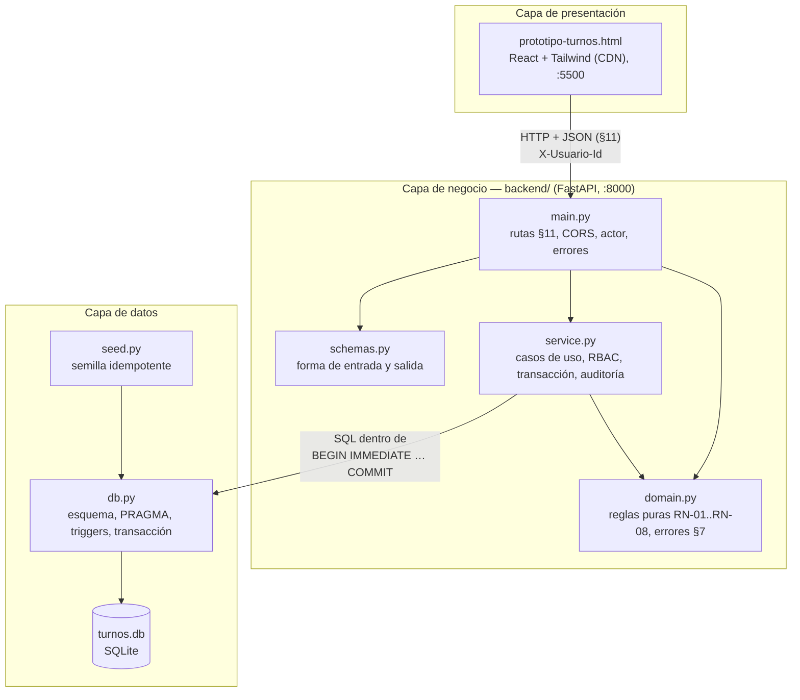

# spec.md — Sistema de Gestión de Turnos y Reservas de Servicios Profesionales

| Campo | Valor |
|---|---|
| Versión | 2.2.0 (Fase 2 — Arquitectura en tres capas explícita) |
| Versión anterior | 2.1.0 (contrato ampliado); 2.0.0 (contrato de turnos); 0.1.0 (MVP, Fase 1 — prototipo en memoria) |
| Estado | Borrador para revisión |
| Metodología | Spec-Driven Development (SDD) |
| Fecha | 2026-11-03 |

> Este documento es el **contrato del sistema**. Todo código, test y decisión de diseño debe poder trazarse a una sección de este archivo. Si el código y la spec divergen, se corrige primero la spec y luego el código.

Palabras clave normativas: **DEBE** (obligatorio), **NO DEBE** (prohibido), **PUEDE** (opcional), según RFC 2119.

### Cambios de la versión 2.2.0

| Sección | Cambio |
|---|---|
| §3, §4, §11 | **Sin cambios.** Reglas, modelo de datos y contrato REST quedan idénticos. |
| §12 | **Nuevo:** arquitectura en tres capas (presentación, negocio, datos), qué módulos forman cada capa, en qué capa se aplica cada regla y las reglas de dependencia entre capas (ARQ-01 a ARQ-07). |

### Cambios de la versión 2.1.0

| Sección | Cambio |
|---|---|
| §3, §4 | **Sin cambios.** INV-01, INV-02 e INV-03 y el modelo de datos quedan idénticos. |
| §8 | Nuevos criterios 13 a 20 (endpoints nuevos). |
| §9 | D-08 resuelta en parte: catálogo, horarios, disponibilidad, bloqueos, servicios, cierre de turnos, auditoría y métricas pasan al contrato. Nueva decisión D-09 (cambio de horario laboral con turnos ya reservados). |
| §10 | Trazabilidad ampliada. |
| §11.1 | Las lecturas públicas (§2.2) aceptan solicitudes sin `X-Usuario-Id`. Nuevo campo opcional `conflictos` en el error de RN-05. |
| §11.6 – §11.14 | **Nuevo:** endpoints de servicios, horario laboral, disponibilidad, bloqueos, completar / ausente, auditoría y métricas. |
| §11.15 | Lo que sigue fuera del contrato (antes §11.6). |

### Cambios de la versión 2.0.0

| Sección | Cambio |
|---|---|
| §3 | Se agrega la **nomenclatura de invariantes de Fase 2**: INV-01 = RN-01 e INV-02 = RN-02. Sus textos quedan **sin cambios**. |
| §3 | Nueva regla **INV-03 — Persistencia Real**. |
| §4 | **Sin cambios.** Es la única fuente de entidades y campos para el backend y la base de datos. |
| §6 | "Consistencia" y "Durabilidad" referencian INV-03. |
| §7 | Se agregan códigos que ya usa el prototipo (`SERVICE_UNAVAILABLE`, `REASON_REQUIRED`) y los nuevos de la API (`UNAUTHENTICATED`, `VALIDATION_ERROR`, `PERSISTENCE_UNAVAILABLE`). |
| §8 | Nuevos criterios 9 a 12 (persistencia y contrato REST). |
| §9 | D-04 resuelta para Fase 2 (SQLite). Nuevas decisiones abiertas D-06 a D-08. |
| §10 | Trazabilidad ampliada. |
| §11 | **Nuevo:** contrato de endpoints REST `/api/turnos`. |

---

## 1. Alcance del MVP

### 1.1 Objetivo
Permitir que clientes reserven turnos con profesionales para servicios con duración definida, y que los profesionales/administradores gestionen su agenda sin conflictos.

### 1.2 Incluido (In scope)

| ID | Capacidad |
|---|---|
| F-01 | Registro e inicio de sesión de usuarios (email + contraseña). |
| F-02 | Catálogo público de servicios (nombre, descripción, duración, precio de referencia, profesional). |
| F-03 | Consulta de disponibilidad por servicio y fecha (slots libres calculados). |
| F-04 | Reserva de turno por parte del Cliente. |
| F-05 | Consulta de "Mis turnos" (próximos e históricos) del Cliente. |
| F-06 | Cancelación de turno propio por el Cliente (sujeta a RN-01). |
| F-07 | Gestión de servicios por el Profesional (alta, edición, baja lógica). |
| F-08 | Definición de horario laboral semanal recurrente del Profesional. |
| F-09 | Bloqueo de rangos horarios (vacaciones, almuerzo, imprevistos). |
| F-10 | Vista de agenda diaria/semanal con todos los turnos del Profesional. |
| F-11 | Cancelación de turno por el Profesional/Administrador (sin restricción de ventana, con motivo). |
| F-12 | Métricas básicas: turnos por período, tasa de cancelación, servicios más reservados, ocupación. |
| F-13 | Notificación por email de confirmación y cancelación. |

### 1.3 Excluido (Out of scope)

- Pagos en línea, señas, reembolsos y facturación.
- Reprogramación directa de turnos (el MVP resuelve con cancelar + reservar nuevo).
- Turnos recurrentes / paquetes de sesiones.
- Lista de espera.
- Múltiples sucursales o recursos físicos (salas, equipos).
- Integración con calendarios externos (Google/Outlook), recordatorios por SMS/WhatsApp.
- Login social / SSO, autenticación multifactor.
- Aplicación móvil nativa (el MVP es web responsive).
- Multi-idioma y multi-moneda (MVP: español, una moneda).
- Reseñas y calificaciones.
- Multi-tenancy (una sola organización por despliegue).

### 1.4 Supuestos

- Una única zona horaria de operación por despliegue (configurable); los instantes se almacenan en UTC.
- Un turno pertenece a **un** profesional y **un** servicio.
- Un profesional atiende un solo turno a la vez (capacidad = 1).
- El cliente final reserva con cuenta registrada (no hay reserva anónima).

---

## 2. Matriz de Roles y Permisos (RBAC)

### 2.1 Roles

| Rol | Descripción |
|---|---|
| `CLIENTE` | Usuario final que reserva servicios. |
| `PROFESIONAL` | Presta servicios; administra su propia agenda y servicios. |
| `ADMIN` | Gestiona toda la operación: todos los profesionales, servicios y usuarios. |
| Anónimo | Visitante sin sesión (solo lectura del catálogo). |

> Para el MVP, `PROFESIONAL` y `ADMIN` comparten el panel de gestión; `ADMIN` amplía el alcance a **todos** los profesionales.

### 2.2 Matriz de permisos

Leyenda: ✅ permitido · ❌ prohibido · 🔒 solo sobre recursos propios

| Recurso / Acción | Anónimo | CLIENTE | PROFESIONAL | ADMIN |
|---|:-:|:-:|:-:|:-:|
| Ver catálogo de servicios | ✅ | ✅ | ✅ | ✅ |
| Ver disponibilidad (slots libres) | ✅ | ✅ | ✅ | ✅ |
| Registrarse / iniciar sesión | ✅ | — | — | — |
| Crear turno | ❌ | ✅ (para sí) | ❌ | ✅ (en nombre de un cliente) |
| Ver turno | ❌ | 🔒 | 🔒 (de su agenda) | ✅ |
| Cancelar turno | ❌ | 🔒 (sujeto a RN-01) | 🔒 (sin ventana mínima) | ✅ (sin ventana mínima) |
| Editar datos de contacto propios | ❌ | 🔒 | 🔒 | ✅ |
| Crear/editar/desactivar servicios | ❌ | ❌ | 🔒 | ✅ |
| Definir horario laboral | ❌ | ❌ | 🔒 | ✅ |
| Bloquear / desbloquear rangos horarios | ❌ | ❌ | 🔒 | ✅ |
| Ver agenda completa | ❌ | ❌ | 🔒 | ✅ |
| Ver métricas | ❌ | ❌ | 🔒 (propias) | ✅ (globales) |
| Gestionar usuarios y roles | ❌ | ❌ | ❌ | ✅ |

### 2.3 Reglas de autorización

- **RBAC-01**: Toda operación DEBE verificar rol **y** propiedad del recurso en el backend; la UI nunca es la barrera de seguridad.
- **RBAC-02**: Un acceso a un recurso ajeno DEBE responder `404` (no `403`) para no revelar su existencia a un `CLIENTE`.
- **RBAC-03**: El rol se asigna únicamente por un `ADMIN`; el auto-registro siempre crea `CLIENTE`.
- **RBAC-04**: Un `CLIENTE` NO DEBE poder ver datos de contacto de otros clientes. El `PROFESIONAL` solo ve los datos de contacto de clientes con turnos en su agenda.

---

## 3. Reglas Invariantes del Negocio

Las siguientes reglas son **no negociables**: se validan en el backend, y la base de datos DEBE reforzarlas con restricciones cuando sea técnicamente posible. Ninguna regla puede ser omitida por la UI ni por un rol (salvo excepción explícita indicada).

### 3.0 Invariantes de la Fase 2 (nomenclatura INV)

A partir de la versión 2.0.0, las tres reglas que gobiernan el backend se identifican como **INV-xx**. INV-01 e INV-02 son **alias** de las reglas existentes: su texto es inmutable y se mantiene exactamente como en la versión 0.1.0. La numeración RN-xx no cambia, para no romper la trazabilidad con el prototipo, la guía de uso y las historias de usuario.

| Invariante | Regla | Estado en v2.0.0 |
|---|---|---|
| **INV-01** | RN-01 — Ventana mínima de cancelación (≥ 2 h) | Inmutable, sin cambios |
| **INV-02** | RN-02 — Prohibición de doble reserva y solapamiento | Inmutable, sin cambios |
| **INV-03** | Persistencia Real (ver al final de esta sección) | **Nueva** |

### RN-01 — Ventana mínima de cancelación

- Un `CLIENTE` NO DEBE cancelar un turno si faltan **menos de 2 horas** para su `inicio`.
- Valor configurable (`CANCELLATION_WINDOW_HOURS`, default `2`); el cálculo usa `inicio - ahora(UTC)`.
- Un turno ya iniciado, finalizado o cancelado NO DEBE ser cancelable.
- **Excepción**: `PROFESIONAL`/`ADMIN` PUEDEN cancelar fuera de ventana, con motivo obligatorio, y el cliente DEBE ser notificado.
- Respuesta ante violación: error `CANCELLATION_WINDOW_EXPIRED` (HTTP 409).

### RN-02 — Prohibición de doble reserva y solapamiento

- Para un mismo profesional, dos turnos en estado activo (`CONFIRMADO`) NO DEBEN solaparse en el tiempo.
- Se define el solapamiento sobre intervalos semiabiertos `[inicio, fin)`: dos turnos A y B se solapan si `A.inicio < B.fin` **y** `B.inicio < A.fin`. Turnos contiguos (`A.fin == B.inicio`) son válidos.
- Un turno NO DEBE solaparse con un bloqueo horario (RN-05) ni quedar fuera del horario laboral del profesional.
- Un mismo cliente NO DEBE tener dos turnos activos solapados (aunque sean con distintos profesionales).
- **Garantía ante concurrencia**: la verificación DEBE ser atómica. Se exige restricción a nivel de base de datos (p. ej. `EXCLUDE USING gist` sobre rango temporal por profesional en PostgreSQL, o transacción con bloqueo + índice único equivalente). Una validación solo en la aplicación NO es suficiente.
- Los turnos `CANCELADO` NO participan del control de solapamiento (el slot se libera).
- Respuesta ante violación: error `SLOT_UNAVAILABLE` (HTTP 409).

### RN-03 — Validación obligatoria de datos de contacto

- Para crear un turno, el `CLIENTE` DEBE tener un perfil con: **nombre completo** (2–100 caracteres), **email válido** (RFC 5322 simplificado, único por usuario) y **teléfono** válido en formato E.164 o equivalente local normalizado.
- El email DEBE estar **verificado** (enlace de confirmación) antes de la primera reserva.
- La reserva NO DEBE persistirse si algún dato de contacto falta o es inválido (error `INVALID_CONTACT`, HTTP 422).
- Los datos se normalizan (trim, minúsculas en email, teléfono a E.164) antes de validar y guardar.

### RN-04 — Integridad temporal del turno

- `inicio` DEBE ser estrictamente futuro respecto a `ahora` al momento de crear el turno, con una **antelación mínima** configurable (default: 1 hora).
- `fin = inicio + duración del servicio`; el cliente NO DEBE enviar `fin` (se calcula en servidor).
- El `inicio` DEBE estar alineado a la grilla de slots del profesional (default: 15 min).
- Existe un **horizonte máximo de reserva** (default: 60 días).
- Todos los instantes se almacenan en UTC y se muestran en la zona horaria de operación.

### RN-05 — Bloqueos horarios

- Un bloqueo es un rango `[inicio, fin)` del profesional en el que no se pueden crear turnos.
- Crear un bloqueo sobre un rango con turnos activos DEBE ser rechazado con listado de conflictos, **salvo** que el profesional confirme cancelarlos (lo cual aplica la excepción de RN-01 y notifica a los clientes).

### RN-06 — Ciclo de vida del turno

Estados: `CONFIRMADO` → `CANCELADO` | `COMPLETADO` | `AUSENTE`.

| Transición | Quién | Condición |
|---|---|---|
| (nuevo) → `CONFIRMADO` | Cliente / Admin | Cumple RN-02, RN-03, RN-04 |
| `CONFIRMADO` → `CANCELADO` | Cliente | Cumple RN-01 |
| `CONFIRMADO` → `CANCELADO` | Profesional / Admin | Motivo obligatorio |
| `CONFIRMADO` → `COMPLETADO` | Profesional / Admin | `ahora ≥ inicio` |
| `CONFIRMADO` → `AUSENTE` | Profesional / Admin | `ahora ≥ fin` |

- Los estados `CANCELADO`, `COMPLETADO` y `AUSENTE` son **terminales**; ninguna transición sale de ellos.
- Un turno NO DEBE eliminarse físicamente; el historial es inmutable (solo cambia de estado).

### RN-07 — Integridad de catálogo

- Un servicio con turnos futuros activos NO DEBE eliminarse; solo desactivarse (baja lógica), lo cual impide nuevas reservas sin afectar las existentes.
- La duración de un servicio DEBE ser múltiplo de la grilla de slots y estar entre 15 min y 8 h.
- Modificar la duración de un servicio NO altera turnos ya confirmados.

### RN-08 — Trazabilidad

- Toda creación, cancelación y cambio de estado DEBE registrar: actor, rol, instante UTC y motivo (si aplica) en un log de auditoría inmutable.

### INV-03 — Persistencia Real

- Los turnos DEBEN persistirse en una **base de datos relacional**. El estado en memoria del navegador (o de cualquier cliente) NO DEBE ser la fuente de verdad de un turno.
- Toda escritura que crea o cambia un turno DEBE ser **atómica**: en una única transacción se ejecutan la verificación de reglas (RN-02, RN-03, RN-04, RN-06), la escritura del `Turno` y el registro del `AuditoriaEvento` (RN-08). O se confirma todo, o no se persiste nada.
- El backend NO DEBE responder con éxito (`2xx`) antes de que la transacción esté confirmada (*commit*) en almacenamiento durable.
- Los turnos confirmados DEBEN **sobrevivir al reinicio** del backend, del servidor del frontend y del navegador: tras reiniciar, `GET /api/turnos` DEBE devolver el mismo conjunto de turnos con los mismos estados.
- La verificación de solapamiento (RN-02) y la inserción DEBEN ocurrir dentro de la misma transacción con bloqueo de escritura, de modo que dos solicitudes concurrentes no puedan confirmar el mismo slot.
- La persistencia DEBE respetar el modelo de la §4: no se agregan entidades ni campos fuera de ella sin modificar antes esta spec.
- Respuesta ante falla de persistencia: error `PERSISTENCE_UNAVAILABLE` (HTTP 503), sin escrituras parciales.

---

## 4. Modelo de Datos Conceptual

### 4.1 Entidades principales

#### Usuario
| Atributo | Tipo | Restricciones |
|---|---|---|
| `id` | UUID | PK |
| `email` | texto | Único, obligatorio, normalizado |
| `email_verificado` | booleano | Default `false` |
| `password_hash` | texto | Obligatorio (nunca en claro) |
| `nombre_completo` | texto | Obligatorio, 2–100 |
| `telefono` | texto | Obligatorio, E.164 |
| `rol` | enum | `CLIENTE` \| `PROFESIONAL` \| `ADMIN` |
| `activo` | booleano | Default `true` |
| `creado_en` | timestamp UTC | |

#### Servicio
| Atributo | Tipo | Restricciones |
|---|---|---|
| `id` | UUID | PK |
| `profesional_id` | UUID | FK → Usuario (rol `PROFESIONAL`) |
| `nombre` | texto | Obligatorio |
| `descripcion` | texto | Opcional |
| `duracion_min` | entero | 15–480, múltiplo de la grilla |
| `precio_referencia` | decimal | ≥ 0, informativo |
| `activo` | booleano | Baja lógica (RN-07) |

#### Turno
| Atributo | Tipo | Restricciones |
|---|---|---|
| `id` | UUID | PK |
| `cliente_id` | UUID | FK → Usuario (rol `CLIENTE`) |
| `profesional_id` | UUID | FK → Usuario (rol `PROFESIONAL`) |
| `servicio_id` | UUID | FK → Servicio |
| `inicio` | timestamp UTC | Futuro al crear (RN-04) |
| `fin` | timestamp UTC | Calculado: `inicio + duración` |
| `estado` | enum | Ver RN-06 |
| `motivo_cancelacion` | texto | Obligatorio si lo cancela Profesional/Admin |
| `cancelado_por_id` | UUID | FK → Usuario, nullable |
| `creado_en` / `actualizado_en` | timestamp UTC | |

*Restricción clave*: exclusión de rangos `[inicio, fin)` por `profesional_id` cuando `estado = CONFIRMADO` (RN-02).

#### Entidades de soporte

| Entidad | Atributos clave | Propósito |
|---|---|---|
| **HorarioLaboral** | `id`, `profesional_id`, `dia_semana` (0–6), `hora_inicio`, `hora_fin` | Disponibilidad semanal recurrente (F-08). |
| **Bloqueo** | `id`, `profesional_id`, `inicio`, `fin`, `motivo` | Rangos no reservables (F-09, RN-05). |
| **AuditoriaEvento** | `id`, `entidad`, `entidad_id`, `accion`, `actor_id`, `rol`, `ocurrido_en`, `detalle` | Trazabilidad inmutable (RN-08). |

### 4.2 Relaciones y cardinalidad

```
Usuario (PROFESIONAL) 1 ──── N Servicio
Usuario (PROFESIONAL) 1 ──── N HorarioLaboral
Usuario (PROFESIONAL) 1 ──── N Bloqueo
Usuario (PROFESIONAL) 1 ──── N Turno      (como profesional atendiendo)
Usuario (CLIENTE)     1 ──── N Turno      (como cliente reservando)
Servicio              1 ──── N Turno
Usuario               1 ──── N AuditoriaEvento (actor)
```



### 4.3 Invariantes de integridad referencial

- `Turno.profesional_id` DEBE coincidir con `Servicio.profesional_id` del `servicio_id` asociado.
- `Turno.cliente_id` y `Turno.profesional_id` DEBEN ser usuarios distintos.
- Ninguna FK usa borrado en cascada sobre `Turno`; el historial se preserva (RN-06, RN-07).

---

## 5. Métricas del MVP (F-12)

| Métrica | Definición |
|---|---|
| Turnos por período | Conteo de turnos `CONFIRMADO`/`COMPLETADO` agrupados por día/semana/mes. |
| Tasa de cancelación | `CANCELADO / total creados` en el período, con desglose por quién canceló. |
| Tasa de ausentismo | `AUSENTE / (COMPLETADO + AUSENTE)`. |
| Ocupación | Minutos reservados / minutos disponibles (horario laboral − bloqueos). |
| Top servicios | Ranking de servicios por cantidad de turnos. |

Alcance: el `PROFESIONAL` ve solo las suyas; el `ADMIN` ve las globales y por profesional.

---

## 6. Requisitos No Funcionales (mínimos del MVP)

- **Seguridad**: contraseñas con hash adaptativo (argon2/bcrypt), HTTPS obligatorio, sesiones con expiración, protección CSRF/XSS, rate limiting en login y reserva.
- **Consistencia**: la creación de turno es transaccional y atómica (RN-02, INV-03).
- **Durabilidad**: ningún turno confirmado se pierde por reinicio del sistema (INV-03).
- **Rendimiento**: consulta de disponibilidad < 500 ms p95 con hasta 50 profesionales.
- **Privacidad**: datos de contacto accesibles solo según RBAC-04; cumplimiento de la normativa local de protección de datos personales.
- **Disponibilidad**: objetivo 99,5 % mensual (sin HA en MVP).
- **Accesibilidad**: WCAG 2.1 AA en flujos de reserva.

---

## 7. Catálogo de Errores de Dominio

| Código | HTTP | Origen |
|---|---|---|
| `SLOT_UNAVAILABLE` | 409 | RN-02, RN-05 |
| `CANCELLATION_WINDOW_EXPIRED` | 409 | RN-01 |
| `INVALID_CONTACT` | 422 | RN-03 |
| `EMAIL_NOT_VERIFIED` | 403 | RN-03 |
| `INVALID_TIME_RANGE` | 422 | RN-04 |
| `INVALID_STATE_TRANSITION` | 409 | RN-06 |
| `SERVICE_HAS_ACTIVE_BOOKINGS` | 409 | RN-07 |
| `FORBIDDEN` / `NOT_FOUND` | 403 / 404 | RBAC-01, RBAC-02 |
| `SERVICE_UNAVAILABLE` | 409 | RN-07 (servicio desactivado; código ya usado por el prototipo) |
| `REASON_REQUIRED` | 422 | RN-01 excepción, RN-06 (motivo obligatorio; código ya usado por el prototipo) |
| `UNAUTHENTICATED` | 401 | §11.1 (solicitud sin actor identificado) |
| `VALIDATION_ERROR` | 422 | §11 (cuerpo o parámetros mal formados) |
| `PERSISTENCE_UNAVAILABLE` | 503 | INV-03 |

---

## 8. Criterios de Aceptación (muestra Given/When/Then)

1. **Doble reserva**: *Dado* un turno `CONFIRMADO` de 10:00–10:30 con el profesional P, *cuando* otro cliente reserva 10:15–10:45 con P, *entonces* el sistema responde `SLOT_UNAVAILABLE` y no persiste nada.
2. **Concurrencia**: *Dado* dos solicitudes simultáneas por el mismo slot, *entonces* exactamente una se confirma y la otra recibe `SLOT_UNAVAILABLE`.
3. **Contigüidad**: *Dado* un turno 10:00–10:30, *cuando* se reserva 10:30–11:00, *entonces* se confirma.
4. **Cancelación en ventana**: *Dado* un turno que inicia en 3 h, *cuando* el cliente cancela, *entonces* pasa a `CANCELADO` y el slot queda libre.
5. **Cancelación fuera de ventana**: *Dado* un turno que inicia en 1 h 59 min, *cuando* el cliente cancela, *entonces* `CANCELLATION_WINDOW_EXPIRED`.
6. **Contacto inválido**: *Dado* un cliente sin teléfono válido, *cuando* intenta reservar, *entonces* `INVALID_CONTACT`.
7. **Aislamiento**: *Dado* el turno T del cliente A, *cuando* el cliente B consulta T, *entonces* recibe `404`.
8. **Bloqueo con conflicto**: *Dado* un turno confirmado dentro de un rango, *cuando* el profesional intenta bloquearlo sin confirmar, *entonces* el sistema lista los conflictos y no crea el bloqueo.
9. **Persistencia ante reinicio (INV-03)**: *Dado* un turno creado con `POST /api/turnos` que respondió `201`, *cuando* se detiene y se vuelve a iniciar el backend, *entonces* `GET /api/turnos` lo devuelve con el mismo `id` y `estado`.
10. **Atomicidad (INV-03)**: *Dado* que la escritura del `AuditoriaEvento` falla dentro de una reserva, *entonces* el `Turno` tampoco se persiste y la respuesta es un error.
11. **Cancelación vía API (INV-01)**: *Dado* un turno del cliente que inicia en 1 h 59 min, *cuando* el cliente llama a `POST /api/turnos/{id}/cancelar`, *entonces* recibe `409 CANCELLATION_WINDOW_EXPIRED` y el turno sigue `CONFIRMADO` en la base.
12. **Solapamiento vía API (INV-02)**: *Dado* un turno `CONFIRMADO` 10:00–10:30 con P, *cuando* dos `POST /api/turnos` simultáneos piden 10:15 con P, *entonces* ambos reciben `409 SLOT_UNAVAILABLE`; y si el slot está libre, exactamente uno responde `201`.
13. **Disponibilidad real (F-03)**: *Dado* un turno `CONFIRMADO` del cliente A 10:00–10:30 con P, *cuando* el cliente B consulta `GET /api/disponibilidad` de ese día, *entonces* 10:00 no figura, 10:30 sí, y la respuesta no identifica a A.
14. **Servicio desactivado (RN-07)**: *Dado* un servicio con turnos futuros, *cuando* el profesional lo desactiva, *entonces* responde `200`, los turnos siguen `CONFIRMADO` y una reserva nueva recibe `409 SERVICE_UNAVAILABLE`.
15. **Bloqueo con conflicto vía API (RN-05)**: *Dado* un turno confirmado dentro del rango, *cuando* se pide `POST /api/bloqueos` sin confirmar, *entonces* `409 SLOT_UNAVAILABLE` con `conflictos` y no se crea nada; *cuando* se confirma con motivo, *entonces* `201`, el turno queda `CANCELADO` y el bloqueo existe, en una sola transacción.
16. **Bloqueo y reserva**: *Dado* un bloqueo, *cuando* se reserva dentro del rango, *entonces* `409 SLOT_UNAVAILABLE`; *cuando* se elimina el bloqueo, *entonces* la reserva se confirma.
17. **Cierre del turno (RN-06)**: *Dado* un turno que todavía no empezó, *cuando* el profesional lo completa, *entonces* `409 INVALID_STATE_TRANSITION`; desde su `inicio`, `completar` responde `200`; `ausente` exige `ahora ≥ fin`; un cliente recibe `403`.
18. **Horario laboral (F-08, D-09)**: *Dado* un turno confirmado un lunes, *cuando* el profesional deja de trabajar los lunes, *entonces* el turno sigue `CONFIRMADO` y ese lunes ya no ofrece disponibilidad.
19. **Auditoría (RN-08)**: *Dado* una reserva y una cancelación, *cuando* el `ADMIN` consulta `GET /api/auditoria`, *entonces* ve `TURNO_CREADO` y `TURNO_CANCELADO` con actor y rol; un `CLIENTE` recibe `403`.
20. **Métricas (F-12)**: *Dado* un período con turnos completados, ausentes y cancelados, *cuando* se consulta `GET /api/metricas`, *entonces* los conteos y tasas coinciden con la §5 y un `PROFESIONAL` solo ve las suyas.

---

## 9. Decisiones Abiertas (a resolver antes de implementar)

| # | Pregunta | Propuesta por defecto |
|---|---|---|
| D-01 | ¿Un cliente puede tener límite de turnos activos simultáneos? | Sin límite en MVP |
| D-02 | ¿Los Profesionales pueden ser dados de alta por auto-registro? | No, solo vía `ADMIN` |
| D-03 | ¿Política de cancelaciones reiteradas / penalización? | Fuera del MVP |
| D-04 | Stack tecnológico y motor de BD (requiere soporte de exclusión de rangos) | **Resuelta para Fase 2:** Python + FastAPI y SQLite (`turnos.db`). SQLite no tiene `EXCLUDE`, así que RN-02 se cumple con la alternativa ya prevista en RN-02: transacción con bloqueo de escritura más restricción en la base (triggers). PostgreSQL queda como opción para producción. |
| D-05 | ¿Confirmación automática o aprobación manual del profesional? | Automática |
| D-06 | ¿Cómo se autentica el actor en la API? | Fase 2: encabezado `X-Usuario-Id` (simula el selector de rol del prototipo). El login real (F-01) se especifica en una versión posterior. |
| D-07 | ¿Dónde se registran los emails de F-13? | La §4 no tiene entidad de emails. En Fase 2 el backend no persiste emails; agregar una entidad requiere modificar antes la §4. |
| D-08 | ¿Qué endpoints exponen catálogo, disponibilidad, bloqueos, horarios y métricas? | **Resuelta en v2.1.0** (§11.6 – §11.13). Sigue pendiente la lectura de usuarios: el frontend conserva la lista local de usuarios, alineada con la semilla. |
| D-09 | ¿Qué pasa con los turnos ya confirmados si cambia el horario laboral? | Se conservan sin cambios (igual que RN-07 con la duración). El nuevo horario solo rige para reservas nuevas. |

---

## 10. Trazabilidad (Spec → Código → Test)

| Spec | Código (a completar) | Test (a completar) |
|---|---|---|
| RN-01 | — | Criterios 4, 5 |
| RN-02 | — | Criterios 1, 2, 3 |
| RN-03 | — | Criterio 6 |
| RBAC-02 | — | Criterio 7 |
| RN-05 | — | Criterio 8 |
| INV-01 (RN-01) | `POST /api/turnos/{id}/cancelar` | Criterios 4, 5, 11 |
| INV-02 (RN-02) | `POST /api/turnos` + restricción en la base | Criterios 1, 2, 3, 12 |
| INV-03 | Capa de persistencia (`turnos.db`) | Criterios 9, 10 |
| F-02, F-03 | `GET /api/servicios`, `GET /api/disponibilidad` | Criterio 13 |
| RN-07 | `POST /api/servicios/{id}/desactivar` | Criterio 14 |
| RN-05 | `POST /api/bloqueos`, `POST /api/bloqueos/{id}/eliminar` | Criterios 8, 15, 16 |
| RN-06 | `POST /api/turnos/{id}/completar`, `/ausente` | Criterio 17 |
| F-08, D-09 | `GET` / `POST /api/horarios` | Criterio 18 |
| RN-08 | `GET /api/auditoria` | Criterio 19 |
| F-12 | `GET /api/metricas` | Criterio 20 |

---

## 11. Contrato de la API REST (Backend)

Este contrato gobierna el Backend de la Fase 2. Toda implementación y todo test de la API DEBEN poder trazarse a esta sección.

### 11.1 Convenciones generales

- **Base URL (desarrollo):** `http://localhost:8000`. Prefijo de recursos: `/api`.
- **Formato:** JSON en UTF-8, tanto en solicitudes como en respuestas.
- **Instantes:** cadenas ISO 8601 en UTC con sufijo `Z` (por ejemplo, `2026-11-03T13:00:00Z`). Ver RN-04.
- **Identificadores:** UUID, como en la §4.
- **Actor:** cada solicitud DEBE identificar al usuario que actúa con el encabezado `X-Usuario-Id: <Usuario.id>`. El backend obtiene el `rol` del `Usuario` en la base, nunca de la solicitud. Sin encabezado, o con un usuario inexistente o inactivo, se responde `401 UNAUTHENTICATED` (ver D-06).
- **Lecturas públicas (v2.1.0):** las que la §2.2 permite al Anónimo (`GET /api/servicios`, `GET /api/horarios`, `GET /api/disponibilidad`) PUEDEN enviarse sin `X-Usuario-Id`. Si el encabezado viene con un usuario inexistente o inactivo, igual se responde `401 UNAUTHENTICATED`.
- **RBAC:** se aplica en el backend según la §2 (RBAC-01). Un turno ajeno se responde como `404 NOT_FOUND` (RBAC-02).
- **Errores:** toda respuesta de error tiene la forma:

  ```json
  { "error": { "codigo": "SLOT_UNAVAILABLE", "mensaje": "Texto legible para la persona usuaria." } }
  ```

  `codigo` DEBE ser uno de la §7. La única extensión permitida es el campo `conflictos` (lista de Turnos, §11.2) en el error de RN-05 de §11.10.

### 11.2 Representación de un Turno

La respuesta expone **exactamente** los atributos de la entidad `Turno` de la §4.1, sin campos adicionales:

```json
{
  "id": "6f1c…",
  "cliente_id": "a2b9…",
  "profesional_id": "c7d0…",
  "servicio_id": "e4f5…",
  "inicio": "2026-11-03T13:00:00Z",
  "fin": "2026-11-03T13:30:00Z",
  "estado": "CONFIRMADO",
  "motivo_cancelacion": null,
  "cancelado_por_id": null,
  "creado_en": "2026-11-01T18:00:00Z",
  "actualizado_en": "2026-11-01T18:00:00Z"
}
```

### 11.3 `GET /api/turnos` — Listar turnos

| Aspecto | Definición |
|---|---|
| Permisos | `CLIENTE`: solo sus turnos (`cliente_id` = actor). `PROFESIONAL`: solo los de su agenda (`profesional_id` = actor). `ADMIN`: todos. Anónimo: `401`. |
| Parámetros de consulta (opcionales) | `estado` (uno de RN-06), `profesional_id`, `desde` y `hasta` (filtran por `inicio`, intervalo `[desde, hasta)`). Un `PROFESIONAL` que filtra por otro `profesional_id` recibe una lista vacía. |
| Orden | Por `inicio` ascendente. |
| Respuesta `200` | Arreglo de Turnos (§11.2). Puede ser vacío. |
| Errores | `401 UNAUTHENTICATED`, `422 VALIDATION_ERROR` (parámetro mal formado), `503 PERSISTENCE_UNAVAILABLE`. |

### 11.4 `POST /api/turnos` — Crear reserva

**Cuerpo:**

```json
{ "servicio_id": "e4f5…", "inicio": "2026-11-03T13:00:00Z", "cliente_id": "a2b9…" }
```

| Campo | Regla |
|---|---|
| `servicio_id` | Obligatorio. Servicio existente y `activo` (RN-07). |
| `inicio` | Obligatorio. Cumple RN-04: futuro con antelación mínima, alineado a la grilla, dentro del horizonte y del horario laboral, sin bloqueos (RN-05). |
| `cliente_id` | Solo lo envía un `ADMIN` (reserva en nombre de un cliente, §2.2). Un `CLIENTE` reserva para sí: si lo envía con otro valor, `403 FORBIDDEN`. |
| `fin`, `profesional_id`, `estado` | **No** se aceptan del cliente: `fin` se calcula como `inicio + Servicio.duracion_min` (RN-04), `profesional_id` se toma del servicio (§4.3) y `estado` nace `CONFIRMADO` (RN-06). Si vienen en el cuerpo, `422 VALIDATION_ERROR`. |

**Datos de contacto (RN-03):** se validan sobre el perfil del `Usuario` cliente ya guardado en la base (`nombre_completo`, `email`, `email_verificado`, `telefono`). La edición del perfil no forma parte de este endpoint.

**Atomicidad (INV-03):** en una única transacción con bloqueo de escritura se verifican RN-02, RN-03, RN-04 y RN-05, se inserta el `Turno` y se registra el `AuditoriaEvento` (`accion = TURNO_CREADO`).

| Resultado | Respuesta |
|---|---|
| Éxito | `201 Created` con el Turno (§11.2) y encabezado `Location: /api/turnos/{id}`. |
| Sin actor | `401 UNAUTHENTICATED` |
| Rol sin permiso (`PROFESIONAL`) o cliente ajeno | `403 FORBIDDEN` |
| Servicio inexistente | `404 NOT_FOUND` |
| Servicio desactivado | `409 SERVICE_UNAVAILABLE` |
| Solapamiento con turno, bloqueo o turno propio del cliente | `409 SLOT_UNAVAILABLE` (INV-02) |
| Email sin verificar | `403 EMAIL_NOT_VERIFIED` |
| Contacto incompleto o inválido | `422 INVALID_CONTACT` |
| Horario inválido (pasado, fuera de grilla, horizonte u horario laboral) | `422 INVALID_TIME_RANGE` |
| Cuerpo mal formado | `422 VALIDATION_ERROR` |
| Falla de la base | `503 PERSISTENCE_UNAVAILABLE` |

### 11.5 `POST /api/turnos/{id}/cancelar` — Cancelar reserva

**Cuerpo:**

```json
{ "motivo": "El profesional no puede asistir." }
```

| Actor | Regla |
|---|---|
| `CLIENTE` | Solo sus turnos. Aplica **INV-01 (RN-01)**: si faltan menos de `CANCELLATION_WINDOW_HOURS` (default 2 h) para `inicio`, `409 CANCELLATION_WINDOW_EXPIRED`. `motivo` es opcional. |
| `PROFESIONAL` | Solo turnos de su agenda. Sin ventana mínima. `motivo` obligatorio: si falta o está vacío, `422 REASON_REQUIRED`. |
| `ADMIN` | Cualquier turno. Sin ventana mínima. `motivo` obligatorio (`422 REASON_REQUIRED`). |

- Solo se cancela un turno `CONFIRMADO` que todavía no comenzó (`ahora < inicio`). En otro caso, `409 INVALID_STATE_TRANSITION` (RN-06). Cancelar dos veces el mismo turno devuelve ese error la segunda vez.
- **Atomicidad (INV-03):** en una única transacción se actualizan `estado = CANCELADO`, `motivo_cancelacion`, `cancelado_por_id` (= actor) y `actualizado_en`, y se registra el `AuditoriaEvento` (`accion = TURNO_CANCELADO`, con el `rol` del actor y el motivo en `detalle`).
- El turno no se borra (RN-06). El slot queda libre para nuevas reservas (RN-02).

| Resultado | Respuesta |
|---|---|
| Éxito | `200 OK` con el Turno actualizado (§11.2). |
| Sin actor | `401 UNAUTHENTICATED` |
| Turno inexistente o ajeno | `404 NOT_FOUND` (RBAC-02) |
| Fuera de ventana (cliente) | `409 CANCELLATION_WINDOW_EXPIRED` (INV-01) |
| Estado no cancelable o turno ya iniciado | `409 INVALID_STATE_TRANSITION` |
| Falta motivo (profesional / admin) | `422 REASON_REQUIRED` |
| Falla de la base | `503 PERSISTENCE_UNAVAILABLE` |

### 11.6 `GET /api/servicios` — Catálogo (F-02)

| Aspecto | Definición |
|---|---|
| Permisos | Todos, incluido el Anónimo (§2.2). |
| Respuesta `200` | Arreglo de Servicios con **exactamente** los 7 atributos de `Servicio` en la §4.1, ordenado por `nombre`. Incluye los desactivados (`activo = false`), que no admiten reservas (RN-07). |
| Errores | `401 UNAUTHENTICATED` (encabezado inválido), `503 PERSISTENCE_UNAVAILABLE`. |

### 11.7 `POST /api/servicios/{id}/activar` y `POST /api/servicios/{id}/desactivar` — Baja lógica (F-07, RN-07)

| Aspecto | Definición |
|---|---|
| Permisos | `PROFESIONAL`: solo sus servicios (ajeno → `404`). `ADMIN`: cualquiera. `CLIENTE`: `403 FORBIDDEN`. |
| Cuerpo | Ninguno. |
| Regla | Desactivar impide nuevas reservas y **no** afecta los turnos ya confirmados (RN-07). Se permite aunque haya turnos futuros: `SERVICE_HAS_ACTIVE_BOOKINGS` aplica solo a la eliminación, que no existe en este contrato. |
| Atomicidad | Si el estado cambia, en una transacción se actualiza `activo` y se registra `AuditoriaEvento` (`SERVICIO_ACTIVADO` / `SERVICIO_DESACTIVADO`). Repetir la acción no cambia nada ni audita. |
| Respuesta `200` | El Servicio actualizado. |
| Errores | `401`, `403 FORBIDDEN`, `404 NOT_FOUND`, `503`. |

### 11.8 Horario laboral (F-08)

**`GET /api/horarios`** — Permisos: todos, incluido el Anónimo. Parámetro opcional `profesional_id`. Respuesta `200`: arreglo de `HorarioLaboral` con exactamente sus 5 atributos de la §4.1, ordenado por `profesional_id`, `dia_semana` y `hora_inicio`. `dia_semana`: 0 = domingo … 6 = sábado.

**`POST /api/horarios`** — Reemplaza el horario semanal completo de un profesional.

```json
{ "profesional_id": "c7d0…", "franjas": [ { "dia_semana": 1, "hora_inicio": "09:00", "hora_fin": "13:00" } ] }
```

| Aspecto | Definición |
|---|---|
| Permisos | `PROFESIONAL`: solo el propio (otro → `404`). `ADMIN`: cualquier profesional. `CLIENTE`: `403`. |
| Reglas | Horas `HH:MM` (de `00:00` a `24:00`) alineadas a la grilla (RN-04) y `hora_inicio < hora_fin`; las franjas de un mismo día no se solapan. En otro caso, `422 INVALID_TIME_RANGE`. Una lista vacía deja al profesional sin horario. Los turnos ya confirmados no se modifican (D-09). |
| Atomicidad | En una transacción se borran las franjas anteriores del profesional, se insertan las nuevas y se registra `AuditoriaEvento` (`HORARIO_ACTUALIZADO`, `entidad_id` = profesional). |
| Respuesta `200` | El nuevo horario del profesional (arreglo de `HorarioLaboral`). |
| Errores | `401`, `403`, `404` (profesional inexistente o ajeno), `422 VALIDATION_ERROR` / `INVALID_TIME_RANGE`, `503`. |

### 11.9 `GET /api/disponibilidad` — Slots libres (F-03)

| Aspecto | Definición |
|---|---|
| Permisos | Todos, incluido el Anónimo (§2.2). |
| Parámetros | `servicio_id` (obligatorio) y `fecha` (`AAAA-MM-DD`, día en la zona de operación, obligatorio). |
| Regla | Devuelve los `[inicio, fin)` alineados a la grilla dentro del horario laboral del profesional que cumplen RN-04 (antelación y horizonte) y no se solapan con turnos `CONFIRMADO` de **cualquier** cliente ni con bloqueos (RN-02, RN-05). No expone quién reservó (RBAC-04). Es la misma regla que aplica `POST /api/turnos`; la reserva sigue siendo la que decide (INV-02). |
| Respuesta `200` | Arreglo de `{ "inicio", "fin" }` (ISO 8601 UTC), ordenado. Puede ser vacío. |
| Errores | `404 NOT_FOUND` (servicio inexistente), `409 SERVICE_UNAVAILABLE` (desactivado), `422 VALIDATION_ERROR` (parámetro faltante o mal formado), `422 INVALID_TIME_RANGE` (fecha pasada o más allá del horizonte), `503`. |

### 11.10 Bloqueos (F-09, RN-05)

**`GET /api/bloqueos`** — `PROFESIONAL`: los suyos. `ADMIN`: todos (filtro opcional `profesional_id`). `CLIENTE`: `403`. Respuesta `200`: arreglo de `Bloqueo` con exactamente sus 5 atributos de la §4.1, ordenado por `inicio`.

**`POST /api/bloqueos`** — Crear un bloqueo.

```json
{ "profesional_id": "c7d0…", "inicio": "2026-11-05T15:00:00Z", "fin": "2026-11-05T16:00:00Z",
  "motivo": "Trámite personal", "confirmar_cancelacion": false }
```

| Aspecto | Definición |
|---|---|
| Permisos | `PROFESIONAL`: solo para sí (otro → `404`). `ADMIN`: cualquier profesional. `CLIENTE`: `403`. |
| Reglas | `inicio < fin` y `fin` futuro; si no, `422 INVALID_TIME_RANGE`. Si hay turnos `CONFIRMADO` del profesional que se solapan con el rango: si alguno ya comenzó, `409 INVALID_STATE_TRANSITION`; si `confirmar_cancelacion` es `false`, `409 SLOT_UNAVAILABLE` con el campo `conflictos` (los turnos afectados) y **no** se crea nada; si es `true`, `motivo` es obligatorio (`422 REASON_REQUIRED`) y los turnos afectados se cancelan con la excepción de RN-01. |
| Atomicidad (INV-03) | En una transacción: cancelación de cada turno afectado con su `AuditoriaEvento` (`TURNO_CANCELADO`), inserción del `Bloqueo` y su `AuditoriaEvento` (`BLOQUEO_CREADO`). |
| Respuesta `201` | `{ "bloqueo": Bloqueo, "turnos_cancelados": [Turno, …] }` y encabezado `Location: /api/bloqueos/{id}`. |
| Errores | `401`, `403`, `404`, `409 SLOT_UNAVAILABLE` / `INVALID_STATE_TRANSITION`, `422 VALIDATION_ERROR` / `INVALID_TIME_RANGE` / `REASON_REQUIRED`, `503`. |

**`POST /api/bloqueos/{id}/eliminar`** — Quita un bloqueo (el rango vuelve a ser reservable). Permisos como en el alta (ajeno o inexistente → `404`). En una transacción se borra el `Bloqueo` y se registra `AuditoriaEvento` (`BLOQUEO_ELIMINADO`). Respuesta `200` con el Bloqueo eliminado.

### 11.11 `POST /api/turnos/{id}/completar` y `POST /api/turnos/{id}/ausente` — Cierre del turno (RN-06)

| Aspecto | Definición |
|---|---|
| Permisos | `PROFESIONAL`: turnos de su agenda. `ADMIN`: cualquiera. `CLIENTE`: `403 FORBIDDEN`. Turno inexistente o ajeno: `404` (RBAC-02). |
| Reglas | Solo desde `CONFIRMADO`. `completar` exige `ahora ≥ inicio`; `ausente` exige `ahora ≥ fin`. En otro caso, `409 INVALID_STATE_TRANSITION`. |
| Atomicidad | Actualización de `estado` y `actualizado_en`, y `AuditoriaEvento` (`TURNO_COMPLETADO` / `TURNO_AUSENTE`) en la misma transacción. |
| Respuesta `200` | El Turno actualizado (§11.2). |

### 11.12 `GET /api/auditoria` — Registro de auditoría (RN-08)

| Aspecto | Definición |
|---|---|
| Permisos | `ADMIN`: todos los eventos. `PROFESIONAL`: los que originó y los de turnos de su agenda. `CLIENTE`: `403`. |
| Respuesta `200` | Arreglo de `AuditoriaEvento` con exactamente sus 8 atributos de la §4.1, del más reciente al más antiguo. Solo lectura: no hay endpoints para modificar la auditoría. |

### 11.13 `GET /api/metricas` — Métricas (F-12, §5)

| Aspecto | Definición |
|---|---|
| Permisos | `ADMIN`: globales o de un profesional (`profesional_id`). `PROFESIONAL`: solo las propias (otro `profesional_id` → `404`). `CLIENTE`: `403`. |
| Parámetros | `desde` y `hasta` (instantes ISO 8601, obligatorios, `desde < hasta`, a lo sumo 366 días; si no, `422 INVALID_TIME_RANGE`). Se consideran los turnos con `inicio` en `[desde, hasta)`. |
| Respuesta `200` | Las métricas de la §5 calculadas en el servidor (ver abajo). |

```json
{
  "desde": "…", "hasta": "…", "total": 12,
  "por_estado": { "CONFIRMADO": 5, "COMPLETADO": 4, "CANCELADO": 2, "AUSENTE": 1 },
  "turnos_por_dia": [ { "fecha": "2026-11-02", "cantidad": 3 } ],
  "tasa_cancelacion": 0.17,
  "cancelaciones_por_rol": { "CLIENTE": 1, "PROFESIONAL": 1, "ADMIN": 0 },
  "tasa_ausentismo": 0.2,
  "ocupacion": 0.35, "minutos_reservados": 420, "minutos_disponibles": 1200,
  "top_servicios": [ { "servicio_id": "e4f5…", "cantidad": 4 } ]
}
```

- `turnos_por_dia`: turnos `CONFIRMADO` o `COMPLETADO` por día de la zona de operación.
- `tasa_cancelacion`: `CANCELADO / total`; `cancelaciones_por_rol` usa el rol del usuario en `cancelado_por_id`.
- `tasa_ausentismo`: `AUSENTE / (COMPLETADO + AUSENTE)`.
- `ocupacion`: minutos de turnos no cancelados / minutos del horario laboral menos los bloqueos, en el período. Las tasas valen `0` si el denominador es `0`.
- `top_servicios`: turnos no cancelados por servicio, de mayor a menor.

### 11.14 Representaciones de §4.1 en v2.1.0

Servicio, HorarioLaboral, Bloqueo y AuditoriaEvento se exponen con exactamente sus atributos de la §4.1, sin campos adicionales, con las mismas convenciones de la §11.1. `Usuario` no se expone en esta versión (RBAC-04).

### 11.15 Fuera de este contrato (v2.1.0)

Registro e inicio de sesión y verificación de email (F-01, D-06), emails (F-13, D-07), alta y edición de servicios (crear, cambiar nombre, duración o precio, F-07) y gestión de usuarios y roles (RBAC-03). Requieren decisiones nuevas y, en el caso de emails y sesiones, cambios en la §4.

---

## 12. Arquitectura en tres capas (v2.2.0)

El sistema se organiza en tres capas: **presentación** (mostrar y capturar intenciones), **negocio** (decidir) y **datos** (recordar). Esta sección fija qué pertenece a cada capa y cómo se pueden depender entre sí. El detalle de implementación y la verificación están en [plan.md](plan.md) §9.



Los módulos `config.py` (parámetros de RN-01, RN-04, CORS y ruta de la base) y `reloj.py` (hora UTC, reemplazable en tests) son **transversales**: los usan varias capas, no contienen reglas ni estado y no importan ningún otro módulo del proyecto. `index.html` es el prototipo de la Fase 1 y queda fuera de esta arquitectura.

### 12.1 Responsabilidades por capa

| Capa | Módulos | DEBE | NO DEBE |
|---|---|---|---|
| Presentación | `prototipo-turnos.html` | Mostrar datos del Backend, capturar intenciones y enviarlas al contrato §11. Traducir `error.codigo` (§7) a mensajes. Mostrar "Sin conexión con el servidor" si el Backend no responde. | Decidir si una operación es válida. Guardar turnos o cualquier entidad de la §4. Caer a datos en memoria cuando no hay conexión. |
| Negocio | `main.py`, `schemas.py`, `service.py`, `domain.py` | Ser la única autoridad sobre RBAC (§2) y RN-01 a RN-08. Aplicar cada escritura y su `AuditoriaEvento` en una sola transacción (INV-03). Responder con el formato de errores de la §11.1. | Conservar estado propio entre solicitudes. Confiar en validaciones hechas por la presentación. |
| Datos | `db.py`, `turnos.db`, `seed.py` | Guardar de forma durable (INV-03) solo las entidades de la §4. Reforzar las invariantes que la base puede garantizar (claves, `CHECK`, triggers) como segunda barrera. | Contener lógica de presentación ni reglas que la base no pueda expresar (RBAC, ventanas de tiempo relativas a "ahora"). |

Dentro de la capa de negocio hay dos niveles:

- **Adaptador HTTP** (`main.py`, `schemas.py`): traduce HTTP a llamadas de casos de uso y excepciones a respuestas. Resuelve el actor con `X-Usuario-Id` (D-06), valida la forma del cuerpo (`422 VALIDATION_ERROR`) y convierte `ErrorDominio` y `sqlite3.Error` en el error de la §11.1.
- **Núcleo de negocio** (`service.py`, `domain.py`): `service.py` contiene los casos de uso (reservar, cancelar, cerrar, bloquear, horarios, servicios, auditoría, métricas): aplica RBAC, abre la transacción, lee y escribe en la base y registra la auditoría. `domain.py` contiene las reglas como funciones puras, sin base de datos ni HTTP.

### 12.2 Dónde se aplica cada regla

| Regla | Negocio: `domain.py` | Negocio: `service.py` | Datos: `db.py` (segunda barrera) |
|---|---|---|---|
| RBAC (§2) | — | Cada caso de uso, con el actor ya resuelto | — |
| RN-01 / INV-01 | `validar_cancelacion` | `cancelar_turno` | — |
| RN-02 / INV-02 | `slots_del_dia` (con `solapa`), para la disponibilidad | `crear_turno` (consulta de solapamiento por profesional y por cliente), `disponibilidad` | `trg_turno_solapamiento` |
| RN-03 | `validar_contacto` | `crear_turno` | `CHECK` de largo de `nombre_completo` |
| RN-04 | `validar_inicio`, `calcular_fin`, `dentro_de_horario`, `validar_franjas` | `crear_turno`, `reemplazar_horario` | `CHECK (inicio < fin)`, `CHECK` de `duracion_min` (múltiplo de 15) |
| RN-05 | `slots_del_dia`, para la disponibilidad | `crear_turno`, `crear_bloqueo` (con `conflictos`) | `trg_turno_solapamiento` (contra `bloqueo`) |
| RN-06 | `validar_cancelacion`, `validar_cierre` | `cancelar_turno`, `cerrar_turno` | `trg_turno_transicion`, `trg_turno_sin_borrado` |
| RN-07 | — | `cambiar_activo_servicio`, `crear_turno` | — |
| RN-08 | — | `_auditar`, en la misma transacción de cada escritura | `trg_auditoria_sin_update`, `trg_auditoria_sin_borrado` |
| INV-03 | — | `db.transaccion` en cada escritura | `BEGIN IMMEDIATE`, `PRAGMA synchronous = FULL`, `foreign_keys = ON` |
| §4.3 | — | — | Claves foráneas, `trg_turno_profesional_servicio` |
| F-12 (§5) | `calcular_metricas`, `minutos_disponibles` | `metricas` | — |

La presentación PUEDE repetir una regla solo como ayuda visual (por ejemplo, avisar que faltan menos de 2 h para el turno), pero el resultado lo decide siempre la respuesta del Backend (RBAC-01).

### 12.3 Reglas de dependencia entre capas

- **ARQ-01 — Presentación solo por contrato.** La presentación DEBE comunicarse con el negocio únicamente por HTTP + JSON según la §11, con la URL concentrada en `API_BASE`. NO DEBE leer `turnos.db` ni depender de módulos de `backend/`.
- **ARQ-02 — Dependencias hacia abajo.** Una capa solo PUEDE depender de la capa inmediatamente inferior y de los módulos transversales. Ninguna capa inferior DEBE conocer a una superior: el negocio no conoce a la presentación y los datos no conocen al negocio.
- **ARQ-03 — Dominio puro.** `domain.py` NO DEBE importar `sqlite3`, `fastapi`, `db`, `service`, `main`, `schemas` ni `reloj`. Solo PUEDE depender de la biblioteca estándar y de `config`. La hora actual le llega como parámetro.
- **ARQ-04 — Núcleo sin HTTP.** `service.py` NO DEBE importar `fastapi`, `main` ni `schemas`. Recibe valores ya validados en su forma y devuelve diccionarios con los atributos de la §4.1; señala los errores con `ErrorDominio` (§7).
- **ARQ-05 — Una sola puerta a la base.** Solo `service.py` (y `seed.py` al arrancar) DEBEN ejecutar SQL y abrir transacciones, siempre con `db.transaccion`. `main.py` solo abre y cierra la conexión de cada solicitud con `db.connect` y NO DEBE ejecutar SQL.
- **ARQ-06 — Datos autónomos.** `db.py` NO DEBE importar módulos del proyecto. Los códigos que levantan sus triggers con `RAISE(ABORT, …)` DEBEN ser códigos de la §7, para que el negocio los traduzca sin conocer el SQL.
- **ARQ-07 — Errores por capas.** La presentación conoce solo `error.codigo` y `error.mensaje` (§11.1). El negocio traduce los errores de la base a códigos de la §7, y cualquier otro fallo de la base a `503 PERSISTENCE_UNAVAILABLE`, siempre después del `ROLLBACK` (INV-03).

**Excepción documentada:** `seed.py` pertenece a la capa de datos pero usa `domain.dentro_de_horario` para que la semilla respete RN-04. Es una herramienta de arranque, no un camino de solicitudes, y no habilita a otros módulos de datos a depender del negocio.
